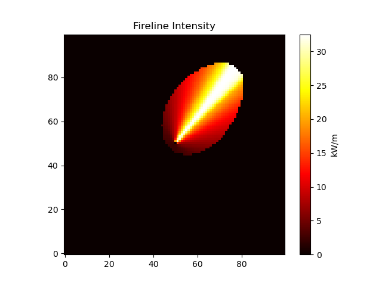
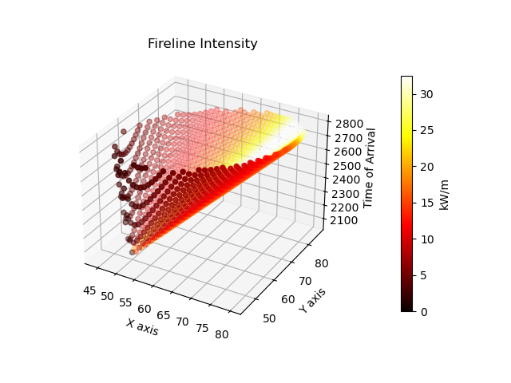

# Summary

`Pyretechnics` is a Python library (implemented in Cython for
performance) for simulating wildland fire spread and behavior. Its
public API enables users to perform a wide variety of scientific
analyses from simple, targeted questions like "how does the spread
rate vary as the wind speed changes" up through landscape scale Monte
Carlo simulations of fire spread and behavior, producing outputs such
as annual burn probabilities and distributions of fire type and
intensity.

Because fires are events that burn finite regions of space within
clearly defined start and end times, Pyretechnics models their
evolution from ignition point or perimeter to final burned area as the
rendering of a three-dimensional shape in space-time, wherein the X-Y
plane represents space and the Z index represents time.

{ width=50% }
{ width=50% }

Users wishing to simulate fire spread and behavior begin by loading
rasters (2D or 3D arrays) of landscape measurements, such as slope,
aspect, wind speed and direction, surface and canopy fuels (e.g.,
grasses, shrubs, downed timber, and trees), and fuel moisture, into
Numpy arrays and then wrapping these in `SpaceTimeCube` objects (from
`pyretechnics.space_time_cube`) to initialize the simulation
environment. They then call functions to set the ignition point(s) or
perimeter(s) and launch the spread algorithm. The results of these
function calls are new Numpy arrays, containing per-cell values for
the fire type, spread rate, spread direction, flame length, fireline
intensity, and time of arrival over the final burned area.

In order to support scientific transparency and encourage critical
feedback from its community of users, Pyretechnics is written as a
**literate program**, meaning that its source code and its
documentation (complete with tables, figures, equations, and
citations) are both generated from the same underlying document. This
literate program documentation can be read here:

[https://pyregence.github.io/pyretechnics](https://pyregence.github.io/pyretechnics)

# Statement of need

`Pyretechnics` implements a wide variety of physical and empirical
equations, which together can be used to predict the evolution of a
fire front and compute related fire behavior metrics (e.g., fire type,
spread rate and direction, fireline intensity, and flame length).

At the core of Pyretechnics is an algorithm for propagating fire
fronts. This involves:

1. Implementations of the standard FBFM13 [@Anderson1982] and FBFM40
   [@ScottBurgan2005] surface fuel models and their related equations
   for calculating dynamic fuel loading, size class weighting factors,
   and live moisture of extinction.

2. The Rothermel model [@Rothermel1972], which computes the
   spread rate and behavior metrics of surface fire in the heading
   direction only.

3. Equations for *elliptical dimensions*, enabling the model to
   calculate the spread rate and behavior metrics of surface fire in
   the direction *normal* to the fire front, by applying the Huygens
   principle [@Anderson1982ModellingSpread;
   @KnightColeman1993PerimeterExpansionHuygens;
   @Richards1995fire2dSpread].

4. Crown fire equations, which extend the above to model the
   combustion of the canopy, which can make the fire front spread
   faster and more intensely. Currently, Pyretechnics implements the
   equations of Cruz and Van Wagner [@Cruz2005; @VanWagner1977].

5. A spotting module, which models the ignition of long-range spot
   fires using equations of Sardoy
   [@Sardoy2008FirebrandDistribution].

6. A numerical solver for tracking the fire front. Currently, that's
   the Eulerian level set method [@Giga2002SurfaceEvolution;
   @Osher2004LevelSetMethods], similarly to ELMFIRE
   ([https://elmfire.io/](https://elmfire.io/)).

Pyretechnics puts a strong emphasis on computing efficiency at the
expense of some physical accuracy. It is suitable for simulating
hundreds of thousands of fire seasons on the scale of a country, with
a pixel resolution on the order of 30m. Pyretechnics does not
currently compute any feedback of the fire on the atmosphere, nor does
it automatically simulate suppression by firefighters or extinction.
However, users can inject firelines onto the landscape via Python
scripting (see `pyretechnics.suppression`), and a weather-based spread
rate adjustment can be used to slow or stop fire spread in response to
changing conditions.

# State of the field

Pyretechnics' modeling capabilities are similar in scope to those of
FARSITE [@Finney2004FARSITE], Prometheus [@Tymstra2010Prometheus], or
ELMFIRE [@Lautenberger2013elmfire]. However, its ergonomics are quite
different because Pyretechnics is meant to be used as a Python library
rather than as a standalone program with a declarative config file
format.

This distinction provides a number of important benefits, including:

1. **Flexibility:** Rather than being constrained by the fixed set of
   options in these models' config files (each of which essentially
   specifies a unique and non-trivial DSL for fire modeling),
   Pyretechnics lets its users craft their experimental designs using
   the full power of the Python programming language. In particular,
   its users can create analytical workflows that its authors did not
   anticipate because they can combine its public API functions in
   novel ways. Notably, its design enables users to interleave their
   own computations into its fire spread simulations by passing
   control back and forth between Pyretechnics and the user.

2. **Ease of Installation and Use:** Pyretechnics can be easily
   imported into any existing Python environment and combined with
   other Python libraries, tools, and frameworks as part of larger
   data science workflows or compute pipelines. There is no software
   to manually compile or install, no config file syntax to learn, and
   no custom input or output file formats to work around. Users just
   load input data into Numpy arrays, call Python functions on them,
   and get Python collections, scalar values, and Numpy arrays back.

3. **Efficiency:** Because fire modeling is computationally intensive,
   Pyretechnics is implemented almost entirely in Cython for
   performance, and its API design makes it easy to parallelize
   simulations using popular Python libraries, such as
   `multiprocessing`, `dask`, and `ray`. As part of larger
   Python-based compute pipelines, Pyretechnics also benefits from
   being able to keep intermediate calculations in memory and pass
   them directly between other Python library functions in the runtime
   rather than needing to serialize intermediate results out to disk
   and then deserialize them back into the next step of a computation.

4. **File Format Support:** Unlike most existing fire models, which
   only support a few input and output file formats, Pyretechnics only
   requires its inputs to be represented as Numpy arrays. Since Python
   includes libraries that can read all prominent GIS formats into
   Numpy arrays, modify them after reading, or even generate new Numpy
   arrays programmatically, Pyretechnics can be used with any file
   formats supported by Python. Similarly, Pyretechnics outputs can be
   written into any (spatial or aspatial) output file format supported
   by Python.

# Software design

The Pyretechnics library provides Python modules (written in the
Python-compatible syntax of Cython for performance) that implement
many of the fundamental equations of fire spread and behavior as
published in the wildland fire science literature. These fall into the
following categories:

- **pyretechnics.fuel_models:** Fuel Model and Moisture Definitions
- **pyretechnics.surface_fire:** Surface Fire Equations
- **pyretechnics.crown_fire:** Crown Fire Equations
- **pyretechnics.spot_fire:** Spot Fire Equations
- **pyretechnics.burn_cells:** Burning Cells on a Grid
- **pyretechnics.eulerian_level_set:** Fire Spread Algorithm (ELMFIRE): Eulerian Level Set Method

Each of these modules builds upon the functions and equations
implemented in those listed above it, while exposing a public API for
users who want to focus their analyses on these low-level elements of
fire modeling, perform verification or validation experiments with
them, or even build their own higher level spread algorithms on top of
them.

In addition, Pyretechnics provides a module for unifying 0D
(constant), 1D (temporal), 2D (spatial), and 3D (spatiotemporal) input
datasets (of potentially different resolutions) for fuels, topography,
wind, and moisture called `pyretechnics.space_time_cube`. These inputs
can be provided as Python scalars, Python lists, or Numpy arrays for
maximum flexibility.

Most of the code in Pyretechnics is written in a functional
programming style, in order to simplify the testing and use of its API
functions. Objects are used only in performance sensitive parts of the
code, where controlled state mutation provides a significant speed-up.
With a few notable exceptions, the public API functions are designed
to take and return only Python scalars and collections.

Importantly, the outputs of the fire spread functions can be fed back
into themselves to resume a "paused" simulation from where it left off
and allow the fire to continue burning until the user's next stop
condition is reached. This design enables user-extensible workflows
which alternate between Pyretechnics' fire spread algorithms and
user-supplied modifications to the landscape or model parameters, such
as for modeling suppression or feedback loops between the fire and the
surrounding environment.

Notably, Pyretechnics is written as a Literate Program, which can be
read online here: https://pyregence.github.io/pyretechnics

Each Python module has its own dedicated chapter, with two subsections:
- For Developers
- For Users

The `For Developers` section contains the **literate programming**
implementation of the module's equations and algorithms for those
interested in understanding the science and engineering decisions used
within it.

The `For Users` section contains **notebook programming** examples of
how to use the public functions in each module along with their
computed outputs. Users can read these sections and cut-and-paste
their example scripts into their own Python files or Jupyter notebooks
to quickly start using the library.

# Research impact statement

Pyretechnics has been and is being used to support various research and applied efforts:

- @Waeselynck2026PointyHeadedFires used Pyretechnics to demonstrate the convex duality between fire shapes and spread rates, heading fire collapse, and related numerical difficulties.
- The Million Acres Strategy project used Pyretechnics to simulate 300,000 California fire seasons for the California Wildfire and Forest Resilience Task Force [@CaliforniaWildfireTaskForce2022RoadmapMillionAcres; @SIG2025MAS].
- Pyretechnics was used in the Wildfire Risk Modeling Exercise [@Pyregence2026WildfireRiskExercise] that informed a report from UL Research Institutes [@Harned2026ULRiskModelingExercise].
- The PyroStack paper uses Pyretechnics as its reference semi-empirical model for comparison with a machine-learning approach [@Kondur2026PyroStack].
- @Waeselynck2026WildfireVerification uses Pyretechnics to illustrate methods for verification of front propagation algorithms.

# AI usage disclosure

No generative AI tools were used in the development of this software,
the writing of this manuscript, or the preparation of supporting
materials.

# Acknowledgements

We acknowledge support from David Saah and Spatial Informatics Group,
LLC in the creation and ongoing development of this software project
and technical inspiration from Chris Lautenberger of CloudFire Inc.

# References
